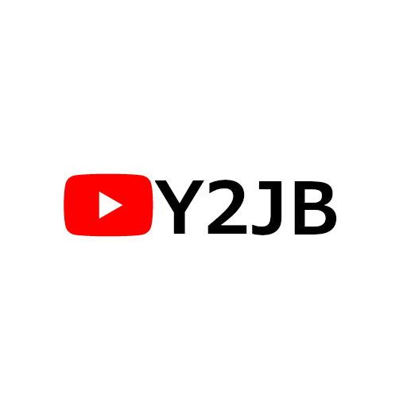

<p align="center">
  
</p>

<h1 align="center">PS5 Y2JB Autoloader</h1>
<h3 align="center">Fork of <a href="https://github.com/Gezine/Y2JB">Y2JB</a></h3>

<p align="center">
  Automatically loads the kernel exploit and your ELF payloads.<br>
  <strong>Supports PS5 firmwares 4.03 – 13.60</strong>
</p>

<p align="center">
  <b>Other Autoloaders:</b><br>
  <a href="https://github.com/itsPLK/ps5-webkit-autoloader">WebKit</a> | 
  <a href="https://github.com/itsPLK/ps5-bdjb-autoloader">BD-JB</a> | 
  <a href="https://github.com/itsPLK/ps5-lua-autoloader">Lua</a>
</p>

<p align="center">
  
</p>

---

## Table of Contents

- [How to Use](#how-to-use)
  - [Option 1: Payload Manager](#-option-1-payload-manager)
  - [Option 2: Manual Config (autoload.txt)](#-option-2-manual-config-autoloadtxt)
- [How to Update](#how-to-update)
- [Setup Instructions](#setup-instructions)
  - [Jailbroken PS5](#jailbroken-ps5-webkit-lua-bd-jb)
  - [Non-Jailbroken PS5](#non-jailbroken-ps5)
- [USB Installer Payload](#usb-installer-payload)
- [Additional Information & FAQ](#additional-information--faq)
- [Credits](#credits)
- [License](#license)
- [Disclaimer](#disclaimer)

---

## How to Use

There are two primary ways to run payloads using the autoloader:

### 🟢 Option 1: Payload Manager

If no `autoload.txt` configuration is detected, the autoloader automatically starts **[Payload Manager](https://github.com/itsPLK/ps5-payload-manager)** — a fully featured PS5 payload manager equipped with a web UI.

- Launch payloads and manage files directly through your web browser without manual configuration files or manual FTP transfers beforehand.
- Simply run the autoloader; if no custom config exists, Payload Manager will handle the rest.

> [!NOTE]
> Payload Manager includes its own built-in autoload feature configured via its web UI, independent of the file-based `autoload.txt` system outlined below.

---

### ⚙️ Option 2: Manual Config (`autoload.txt`)

For a direct, headless, and chained execution sequence:

1. Create a directory named `ps5_autoloader`.
2. Inside `ps5_autoloader`, place your `.elf` / `.bin` files alongside an `autoload.txt` file.
   - List payloads line-by-line (e.g., `etaHEN.elf`).
   - File names are **case-sensitive**.
   - Use `!<milliseconds>` for timed delays (e.g., `!1000` delays execution by 1000 ms).
3. Place the `ps5_autoloader` directory in one of the following locations (checked in order of priority):
   - **Root of a USB drive** (Highest Priority)
   - **Internal storage:** `/data/ps5_autoloader`

> [!TIP]
> If an `autoload.txt` file is present, Payload Manager will **not** launch automatically. If you still want Payload Manager available alongside automated payloads, place `pldmgr.elf` inside your `ps5_autoloader` folder and add it to `autoload.txt`.

---

## How to Update

To update the autoloader:

1. Download **`y2jb_update.zip`** from the [Releases](https://github.com/itsPLK/ps5_y2jb_autoloader/releases) section.
2. Copy `y2jb_update.zip` to the **root** of an exFAT/FAT32 formatted USB drive.
3. Plug the drive into the PS5 and start YouTube. The autoloader will detect and install the update automatically.

---

## Setup Instructions

> [!IMPORTANT]
> **Relapse Network Requirement:**  
> Relapse requires an active network interface (Wi-Fi or Ethernet connected to a local router; internet connectivity is **not** required).
> - **FW 7.00 – 10.01:** Relapse is selected if a network connection is detected (falls back to Lapse otherwise).
> - **FW 10.20 – 13.60:** An active network interface is strictly required.

### Jailbroken PS5 (WebKit, Lua, BD-JB)

#### 1. Target YouTube Version Compatibility

Install the YouTube app matching your current firmware version:

| Firmware Range | YouTube Title IDs | Required App Version |
| :--- | :--- | :--- |
| **4.03 – 12.40** | `PPSA01650` / `PPSA01651` / `PPSA01652` | `v01.000.003` |
| **12.60 – 13.20** | `PPSA01650` / `PPSA01651` / `PPSA01652` | `v01.000.030` |
| **13.40 – 13.60** | `PPSA01650` / `PPSA01651` / `PPSA01652` | `v01.009.253` |

#### 2. Deploy Image via FTP

Releases ship with both `download0.dat` (raw UFS2 image, ~321 MB) and `download0.dat.zip` (~1–2 MB). The PS5 requires the **uncompressed** raw image.

```bash
# If you downloaded download0.dat.zip, extract it first:
unzip download0.dat.zip

# Connect to PS5 FTP server:
ftp <PS5_IP>

# Upload download0.dat to your YouTube directory:
put download0.dat /user/download/PPSA01650/download0.dat
```

*(Alternatively, use the standalone [USB Installer Payload](#usb-installer-payload) to stream and decompress directly on console).*

---

### Non-Jailbroken PS5

If your console is not jailbroken:

1. Restore a system backup configured with Y2JB / Autoloader. *(Note: System backups are not distributed in this repository).*
2. After restoring:
   - **Option A:** FTP `download0.dat` to `/user/download/PPSA01650/download0.dat`.
   - **Option B:** Install YouTube from another supported region and FTP `download0.dat` to that respective directory (`/user/download/PPSA0165*/download0.dat`).

---

## USB Installer Payload

A standalone payload is provided to deploy `download0.dat` entirely offline from a connected USB drive directly into `/user/download/PPSA0165*/`.

### Building the Payload

Requires [ps5-payload-sdk](https://github.com/ps5-payload-dev/sdk).

```bash
./build_usb_payload.sh
```

### Usage

1. Format a USB drive as **FAT32** or **exFAT**.
2. Place either `download0.dat.zip` or `download0.dat` on the root of your USB drive.  
   *(If both are present, the compressed `.zip` is prioritized for faster transfers and direct stream extraction).*
3. Insert the USB drive into your PS5.
4. Send the compiled installer ELF to port `9021`:

```bash
nc -w 3 <PS5_IP> 9021 < build/usb-y2jb-installer.elf
```

---

## Additional Information & FAQ

<details>
<summary><b>How to set up different autoload configs for multiple YouTube apps?</b></summary>
<br>

If you use multiple YouTube installations across different regions, you can suffix the directory name with the target title ID (e.g., `ps5_autoloader_PPSA01650`). App-specific directories always take precedence over the generic `ps5_autoloader` directory.

```text
USB Root
├── ps5_autoloader_PPSA01650/
│   └── autoload.txt
├── ps5_autoloader_PPSA01651/
│   └── autoload.txt
└── ps5_autoloader/
    └── autoload.txt          (Generic fallback)
```
</details>

<details>
<summary><b>How to use a custom ELF Loader version?</b></summary>
<br>

By default, the autoloader uses an embedded `elfldr` restricted to `localhost` (connections originating only from the PS5 itself) to prevent unauthorized network access.

To load your own ELF loader instance capable of external listening:

1. Place your ELF loader binary (e.g., `elfldr.elf`) in your `ps5_autoloader` directory.
2. Add `elfldr.elf` to the top of `autoload.txt`.
3. If chaining payloads behind it, insert a delay command (e.g., `!4000` for 4 seconds) to give the new socket listener adequate startup time:

```text
# Example autoload.txt:
elfldr.elf
!4000
etaHEN.elf
```
</details>

---

## Credits

- **[Gezine](https://github.com/Gezine)** – Original creator of Y2JB
- **shahrilnet**, **null_ptr** – Remote Lua Loader reference implementations
- **BenNoxXD** – ClosePlayer reference
- **ntfargo** – V8 CVE discoveries and CTF documentation
- **abc** & **psfree team** – Lapse implementation
- **matem6** – P2JB implementation
- **edisnord**, **notmaj0r** – Relapse implementations
- **flat_z**, **LM** – GPU RW via direct `ioctl` assistance
- **john-tornblom**, **EchoStretch** – `elfldr.elf` payload
- **hammer-83** – BD-J PS5 exploit references
- **zecoxao**, **idlesauce**, **TheFlow** – Troubleshooting `dlsym`
- **Dr.Yenyen** & **PS5 R&D Community** – Testing Y2JB
- **Rush** – Y2JB backup creation
- **Feyzee61** – `download0.dat` generator workflow
- **ufm42** – Post-jailbreak all-in-one shellcode (`kexp`)

---

## License

- All additions and modifications in this fork are licensed under the **GNU General Public License v3.0** ([GPL-3.0](LICENSE)).
- Original base code by Gezine remains under the **MIT License** (see [LICENSE-MIT](LICENSE-MIT)).

---

## Disclaimer

This project is intended strictly for educational, research, and reverse engineering purposes. It is provided "as is" without warranty of any kind. The contributors and maintainers assume no liability for damaged hardware, system instability, or loss of data resulting from the use of this software.